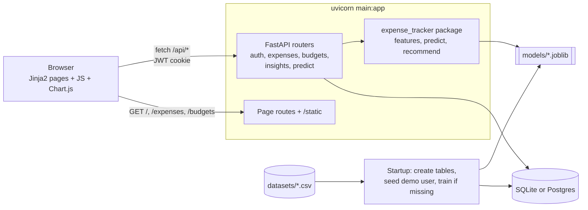

# Expense Tracker

[](https://github.com/mohnish4code/Expense-Tracker-Project/actions/workflows/tests.yml)


A personal expense tracker with monthly budgets and three small ML features: unusual-expense detection,
end-of-month overspend prediction and budget recommendations. One FastAPI process serves the API and the web UI.

## Tech stack

- **Backend:** FastAPI, SQLAlchemy, Pydantic
- **Database:** SQLite by default, Postgres (for example Supabase) by setting `DATABASE_URL`
- **Auth:** bcrypt password hashes, JWT in an HttpOnly cookie
- **Frontend:** Jinja2 templates, plain JavaScript, Chart.js from a CDN. No build step.
- **ML:** pandas, scikit-learn (Isolation Forest, Random Forest), joblib
- **Tooling:** pytest, ruff, GitHub Actions

## Features

- Register, sign in and sign out. Every expense and budget belongs to one user.
- Add, edit, delete and filter expenses (date, category, amount, payment method, recurring flag, description).
- Set a budget per category and month, or fill a month from the recommended budgets.
- Dashboard for any month: budget, spent, remaining and usage cards, spending by category vs budget,
  monthly trend, unusual expenses, overspend risk per category and recommended budgets.
- Anomaly check when an expense is saved. The UI warns if the amount looks unusual for its category.
- Swagger docs for the API at `/docs`.
- A demo account with one year of sample data, created on first start.

## Architecture



## Project structure

```
├── main.py                  # uvicorn entry point
├── backend/
│   ├── app.py               # app factory, mounts routers and static files
│   ├── db.py                # engine and session
│   ├── models.py            # ORM tables
│   ├── schemas.py           # request and response models
│   ├── auth.py              # password hashing, JWT cookie, auth routes
│   ├── startup.py           # create tables, seed demo data, train models if missing
│   └── routers/             # expenses, budgets, insights, predict, pages
├── frontend/
│   ├── templates/           # login, dashboard, expenses, budgets
│   └── static/              # css/, js/
├── src/expense_tracker/
│   ├── config.py            # paths, TND_TO_INR, seed, categories
│   ├── data.py              # load, clean and convert the CSVs
│   ├── features.py          # cutoff features and category amount features
│   ├── train_anomaly.py
│   ├── train_overspend.py
│   ├── recommend.py
│   └── predict.py           # load, save and apply the models
├── notebooks/eda.ipynb
├── datasets/                # transactions.csv, budget.csv
├── models/                  # trained pipelines + metadata json
├── results/metrics.json
├── tests/
└── Dockerfile
```

## Quickstart

Requires Python 3.11 or 3.12.

```bash
python -m venv .venv
source .venv/bin/activate        # Windows: .venv\Scripts\activate
pip install -r requirements.txt
uvicorn main:app --reload
```

Open http://127.0.0.1:8000 and sign in with `demo` / `demo123`.

On the first start the app creates `expense_tracker.db`, loads the sample data into the demo account and,
if `models/*.joblib` is missing, trains both models (about 3 seconds). Later starts skip these steps.

No environment variables are required. Copy `.env.example` to `.env` to override `DATABASE_URL` or `SECRET_KEY`.
Without `SECRET_KEY` a random key is generated on each start, so you have to sign in again after a restart.

To retrain the models by hand:

```bash
python -m expense_tracker.train_anomaly
python -m expense_tracker.train_overspend
```

### Docker (optional)

```bash
docker build -t expense-tracker .
docker run -p 8000:8000 expense-tracker
```

### Tests

```bash
pip install -r requirements-dev.txt
ruff check . && ruff format --check .
pytest --cov
```

## API endpoints

All routes except register and login need the auth cookie (or `Authorization: Bearer <token>`).

| Method | Path | Description |
| --- | --- | --- |
| POST | `/api/auth/register` | Create an account and sign in |
| POST | `/api/auth/login` | Sign in, sets the cookie |
| POST | `/api/auth/logout` | Clear the cookie |
| GET | `/api/auth/me` | Current user |
| POST | `/api/expenses` | Add an expense |
| GET | `/api/expenses` | List expenses, filter by `year`, `month`, `category` |
| PUT | `/api/expenses/{id}` | Update an expense |
| DELETE | `/api/expenses/{id}` | Delete an expense |
| POST | `/api/budgets` | Set the budget for a category and month (creates or updates) |
| GET | `/api/budgets` | List budgets, filter by `year`, `month` |
| GET | `/api/months` | Months that have expenses or budgets |
| GET | `/api/insights/{year}/{month}` | Totals, per-category usage, monthly trend, unusual expenses |
| POST | `/api/predict/anomaly` | Check one amount for a category |
| GET | `/api/predict/overspend/{year}/{month}` | Overspend probability per category, optional `day` |
| GET | `/api/recommendations` | Recommended budget per category |

Validation: amount must be above 0, category and payment method must be known values, dates must be real dates.
Invalid input returns 422.

## ML models

### Anomaly detection

Isolation Forest pipeline on variable-amount expenses. Features:

- amount divided by the category median
- MAD-based z-score per category, `(amount - median) / (1.4826 * MAD)`
- log amount
- one-hot category and payment method

Category statistics are learned inside the pipeline, so the saved model carries them.
Recurring fixed payments (rent, utilities, subscriptions, savings) are handled separately:
they are compared with their usual amount using the same MAD-based z-score, with a threshold of 3.5.
This keeps monthly rent from being flagged just because it is large.

### Overspend prediction

Predicts whether a category will end the month over budget, using only data available partway through the month.
For each category-month and cutoff day (7, 14, 21) the features are:

- spend to date, budget, spend to date / budget
- days elapsed, days remaining, daily run-rate
- previous month's spend / budget
- one-hot category

The label is whether the full month ended over budget. Training uses the first 9 months and testing uses the last 3,
so the test set is always later than the training data. The final model is refit on all months.

In the app, the current month uses today's date as the cutoff. Past months use day 14 by default, and the
dashboard lets you pick 7, 14 or 21.

### Budget recommendation

For each category: the 80th percentile of monthly spend over the last 6 months (months with no spend count as 0),
rounded up to the next 100. Each recommendation comes with a one-line reason.

## Results

From `results/metrics.json`, written by the training scripts.

**Overspend prediction** (test: last 3 months, 126 rows, 45% positive)

| Model | Precision | Recall | F1 | ROC-AUC |
| --- | --- | --- | --- | --- |
| Random Forest | 0.883 | 0.930 | 0.906 | 0.942 |
| Baseline: run-rate projection > budget | 0.518 | 0.754 | 0.614 | 0.610 |

**Anomaly detection** (test: last 3 months of variable expenses, 160 real rows + 16 injected anomalies
with the amount scaled 5-15x)

| Model | Precision | Recall | F1 |
| --- | --- | --- | --- |
| Isolation Forest pipeline | 0.652 | 0.938 | 0.769 |
| Baseline: per-category z-score > 3 | 0.778 | 0.875 | 0.824 |

The dataset has no labelled anomalies, so this test uses synthetic ones. On this test the simple z-score rule
has a higher F1 because it raises fewer false alarms. The Isolation Forest catches more of the injected anomalies.

## Dataset

A Tunisian personal-finance sample for 2024: 792 transactions (769 expenses, 23 income) with French
descriptions and amounts in TND, plus a monthly budget per category for 14 categories. Amounts and budgets
are converted to INR at a fixed rate of 29 (`TND_TO_INR` in `config.py`).

The original source and license of the dataset are not documented yet.

## Limitations

- One year of sample data from a single person.
- A fixed exchange rate for the whole year.
- The overspend model is trained on a small sample: 168 category-months, 504 rows after the cutoffs.
- The anomaly evaluation uses injected anomalies, not real labelled ones.
- Models are trained on the sample dataset, not on each user's own history.

## Future work

- Retrain per user once they have enough history.
- Import bank statements (CSV).
- Email alerts when a category's overspend risk is high.
- Live exchange rates and multi-currency accounts.

## Author

Mohnish Shandilya · [GitHub](https://github.com/mohnish4code)
